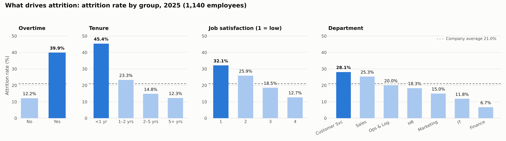

# Retention & Risk Analysis | SQL (MySQL)

**Business question:** A Dubai retail company lost **239 of 1,140 employees (21%)** in 2025. Why are people leaving, which teams are most affected, and **who is likely to leave next**?

> **Data:** simulated HR data for a Dubai company (AED salaries, UAE Nationals and Expats), designed from my HR and talent-acquisition background. Four linked tables.

## Data model
| Table | Rows | Contents |
|---|---|---|
| `employees` | 1,140 | Department, job level, hire date, monthly salary (AED), overtime, nationality group |
| `departments` | 7 | Department name and division |
| `performance` | 1,140 | 2025 rating, job satisfaction, work-life balance, training hours |
| `exits` | 239 | Only leavers: exit date, voluntary/involuntary, reason |

`employees` links to `departments` on `dept_id`, and to `performance` and `exits` on `emp_id`. Attrition uses a **LEFT JOIN** to `exits`, so employees who stayed are kept (as NULL).

## SQL skills used
17 queries in [`retention_analysis.sql`](retention_analysis.sql):
- **JOINs** across 4 tables (INNER and LEFT JOIN)
- **CASE WHEN** for tenure bands, status labels and a points-based risk score
- **Window functions:** `NTILE` (pay quartiles within job level), `RANK` (department ranking), `ROW_NUMBER` (top 3 per department), `SUM() OVER` (running total, share of total)
- **CTEs** (`WITH`), a reusable **VIEW**, `TIMESTAMPDIFF`, `COALESCE`

## Key findings
| Driver | Highest attrition | Lowest attrition |
|---|---|---|
| **Overtime** | Yes: **39.9%** | No: 12.2% |
| **Tenure** | Under 1 year: **45.4%** | 5+ years: 12.3% |
| **Job satisfaction** | Score 1: **32.1%** | Score 4: 12.7% |
| **Department** | Customer Service: **28.1%**, Sales: 25.3% | Finance: 6.7% |
| **Pay within level** | Lowest-paid quarter: **28.7%** | 3rd quarter: 16.1% |

1. **Overtime is the strongest driver.** Overtime staff are 32% of the workforce but 60% of all leavers. In Sales, half of the employees on overtime left.
2. **The first year is the danger zone:** 45% of new joiners left within 12 months.
3. **Front-line teams carry the problem:** Customer Service and Sales account for 62% of all leavers.
4. **Leavers earn AED 1,476 less per month** than stayers on average, and the lowest-paid quarter in each job level leaves most.
5. **Better pay (29%) and career growth (28%)** are the top voluntary exit reasons.
6. **79 high performers (rating 4–5) resigned**, most of them in Sales (25) and Customer Service (22).
7. **Exits are accelerating:** 80 in Jan–Jun against 159 in Jul–Dec.

## Flight-risk score
An explainable points score for current employees, built from the drivers above:

| Warning sign | Points |
|---|---|
| Works overtime | 3 |
| Joined less than 24 months ago | 2 |
| Job satisfaction 1–2 | 2 |
| Work-life balance = 1 | 1 |
| Entry-level role | 1 |

**Validated on 2025 data:** employees scored High (6+) left at **51.2%**, against **7.4%** for Low (0–2).

| Risk level | Current employees |
|---|---|
| High | **103** |
| Medium | 383 |
| Low | 415 |

The 103 high-risk employees are exported in [`high_risk_employees.csv`](high_risk_employees.csv), and `ROW_NUMBER` gives each department its top 3 names for stay interviews.

## Recommendations
1. **Control overtime in front-line teams:** cap hours, add part-time or seasonal cover for peaks, and make sure overtime is paid in line with UAE Labour Law.
2. **Strengthen onboarding:** 30/60/90-day check-ins, a buddy system, and realistic job previews during recruitment.
3. **Targeted pay review** for the lowest-paid quarter in each level, rather than an across-the-board increase.
4. **Stay interviews** this month for the 103 high-risk employees, starting with the top 3 in each department.
5. **Retain top performers** with clear promotion paths in Sales and Customer Service.
6. **Emiratisation:** UAE Nationals range from 4.4% (Marketing) to 9.5% (Finance) of current headcount, so focus Emirati hiring and retention on the lowest departments.

## Files
| File | Contents |
|---|---|
| `retention_analysis.sql` | All SQL: tables, 17 analysis queries, risk-score view |
| `data/` | departments.csv, employees.csv, performance.csv, exits.csv |
| `high_risk_employees.csv` | Current employees with a risk score of 6+ |
| `attrition_drivers.png` | Summary chart |
